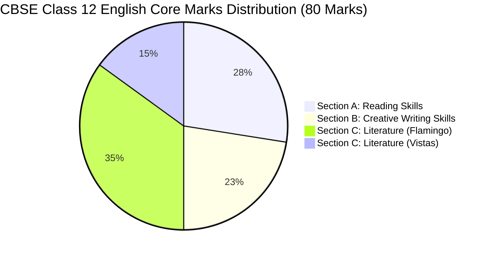

# CBSE Class 12 English Core (Code 301) — 5-Year Comprehensive Trend Analysis & 2027 Examination Blueprint

---

## 1. Executive Summary & Syllabus Foundation

This trend analysis evaluates the previous 5 years of CBSE Class 12 English Core (Subject Code 301) board examinations across **93 distinct question papers** spanning **2022 to 2026** (including Main Board Examination Series, All India / Delhi / Foreign zones, and Compartment / Supplementary Examinations).

### Official Syllabus Authority
- **Prescribed Textbooks**:
  1. *Flamingo*: English Reader (NCERT) — Prose (8 chapters) & Poetry (5 poems).
  2. *Vistas*: Supplementary Reader (NCERT) — 6 chapters.
- **Reference Official Documents**:
  - `02-Class 12 - English - CBSE Syllabus.pdf` (CBSE Curriculum Class XII English Core 301)
  - `English Core-Marking Scheme.pdf` (CBSE Official Marking Scheme & Value Points)
  - `cbse_class12_english_questions.json` (Unified Question Bank: 1,236 questions)
  - `cbse_class12_english_papers.json` (Hierarchical 93-paper database)

---

## 2. Year-by-Year Paper Pattern Evolution (2022 – 2026) & 2027 Predicted Blueprint

| Academic Year | Total Marks | Duration | Total Questions | Section A (Reading) | Section B (Writing) | Section C (Literature) | Standalone Grammar |
| :--- | :---: | :---: | :---: | :---: | :---: | :---: | :---: |
| **2022 (Term 2)** | 40 | 2 Hours | 6 | 14 Marks (2 Passages: 8m + 6m) | 8 Marks (Q3: 3m, Q4: 5m) | 18 Marks (Q5: 5×2=10m, Q6: 2×4=8m) | 0 Marks |
| **2023** | 80 | 3 Hours | 13 | 20 Marks (Q1: 10m, Q2: 10m) | 20 Marks (Q3: 5m, Q4: 5m, Q5: 5m, Q6: 5m) | 40 Marks (Q7: 6m, Q8: 4m, Q9: 4m, Q10: 10m, Q11: 4m, Q12: 5m, Q13: 5m) | 0 Marks |
| **2024** | 80 | 3 Hours | 13 | 22 Marks (Q1: 12m, Q2: 10m) | 18 Marks (Q3: 4m, Q4: 4m, Q5: 5m, Q6: 5m) | 40 Marks (Q7: 6m, Q8: 4m, Q9: 4m, Q10: 10m, Q11: 4m, Q12: 5m, Q13: 5m) | 0 Marks |
| **2025** | 80 | 3 Hours | 13 | 22 Marks (Q1: 12m, Q2: 10m) | 18 Marks (Q3: 4m, Q4: 4m, Q5: 5m, Q6: 5m) | 40 Marks (Q7: 6m, Q8: 4m, Q9: 4m, Q10: 10m, Q11: 4m, Q12: 5m, Q13: 5m) | 0 Marks |
| **2026** | 80 | 3 Hours | 13 | 22 Marks (Q1: 12m, Q2: 10m) | 18 Marks (Q3: 4m, Q4: 4m, Q5: 5m, Q6: 5m) | 40 Marks (Q7: 6m, Q8: 4m, Q9: 4m, Q10: 10m, Q11: 4m, Q12: 5m, Q13: 5m) | 0 Marks |
| **2027 (Predicted)** | **80** | **3 Hours** | **13** | **22 Marks (Q1: 12m, Q2: 10m)** | **18 Marks (Q3: 4m, Q4: 4m, Q5: 5m, Q6: 5m)** | **40 Marks (Q7: 6m, Q8: 4m, Q9: 4m, Q10: 10m, Q11: 4m, Q12: 5m, Q13: 5m)** | **0 Marks** |

> [!IMPORTANT]
> **Clarification on Grammar**:
> As verified in `02-Class 12 - English - CBSE Syllabus.pdf` (pages 9–12) and all 93 papers from 2022 to 2026, **CBSE Class 12 English Core (Code 301) DOES NOT HAVE a separate Grammar section**. Grammar is tested in Class 9 and 10, and in Class 11 (7 marks). In Class 12, grammatical competence is assessed strictly under the rubric **"Accuracy of Spelling and Grammar"** (1 mark each in Questions 3, 4, 5, 6 = 4 marks total) and under **"Expression"** in Literature long answers.

---

## 3. Sectional Weightage & Detailed Structural Breakdown

### Section A: Reading Skills (22 Marks)
- **Question 1: Unseen Passage (Discursive / Descriptive / Literary)** — **12 Marks**
  - Length: 700 – 750 words.
  - Question distribution: 9 to 10 sub-questions comprising MCQs, single-sentence completions, vocabulary in context, tone identification, and short inferential responses (1–2 marks each).
- **Question 2: Case-Based Unseen Factual Passage (with Visual / Data input)** — **10 Marks**
  - Length: 350 – 400 words with statistical table, bar chart, or pie chart.
  - Question distribution: 8 to 9 sub-questions assessing analytical interpretation, comparative data reading, and synthesis.

### Section B: Creative Writing Skills (18 Marks)
- **Question 3: Short Writing Task — Notice Writing** — **4 Marks** (Word limit: 50 words)
  - Internal choice between two options: Option (a) vs Option (b).
  - Marking: Format: 1 mark | Content: 2 marks | Accuracy of Spelling & Grammar: 1 mark.
- **Question 4: Short Writing Task — Formal / Informal Invitation & Reply** — **4 Marks** (Word limit: 50 words)
  - Internal choice between two options: Card format vs Letter format, or Invitation vs Reply (Acceptance/Refusal).
  - Marking: Format: 1 mark | Content: 2 marks | Accuracy of Spelling & Grammar: 1 mark.
- **Question 5: Long Writing Task — Formal Letter** — **5 Marks** (Word limit: 120 – 150 words)
  - Internal choice between (a) Letter to the Editor and (b) Job Application with detailed Bio-data / Curriculum Vitae.
  - Marking: Format: 1 mark | Organisation of Ideas: 1 mark | Content: 2 marks | Accuracy: 1 mark.
- **Question 6: Long Writing Task — Article / Report Writing** — **5 Marks** (Word limit: 120 – 150 words)
  - Internal choice between (a) Article Writing and (b) Report Writing (Newspaper or School Magazine).
  - Marking: Format: 1 mark | Organisation of Ideas: 1 mark | Content: 2 marks | Accuracy: 1 mark.

### Section C: Literature Textbook and Supplementary Reader (40 Marks)
- **Flamingo Book Total Weightage**: **28 Marks** (Extracts: 6m Poetry + 4m Prose; Short Answers: 10m; Long Answer: 5m)
- **Vistas Book Total Weightage**: **12 Marks** (Extract: 4m Prose; Short Answers: 4m; Long Answer: 5m)
  *(Note: Long answers Q12 is 5m Flamingo, Q13 is 5m Vistas).*

---

## 4. Comprehensive Heat-Map & 2027 Outlook Matrix

The following matrix tracks appearances across all official board examination sessions from 2022 to 2026 and predicts the likelihood for the **2027 Board Examination**.

### A. Flamingo: Prose Chapters

| Chapter | Author | 2022 (T2) | 2023 | 2024 | 2025 | 2026 | 5-Year Frequency | 2027 Outlook | Primary Exam Roles |
| :--- | :--- | :---: | :---: | :---: | :---: | :---: | :---: | :---: | :--- |
| **1. The Last Lesson** | Alphonse Daudet | — | ✓ | ✓ | ✓ | ✓ | Very High (32) | **Certain** | Short Answer (Franz/M. Hamel), Q8 Extract, Language Pride |
| **2. Lost Spring** | Anees Jung | — | ✓ | ✓ | ✓ | ✓ | Very High (34) | **Certain** | Q8 Extract, Short Answer (Saheb/Mukesh), Long Answer (Child labour) |
| **3. Deep Water** | William Douglas | — | ✓ | ✓ | ✓ | ✓ | High (24) | **High** | Q8 Extract (YMCA pool terror), Short Answer (Instructor training) |
| **4. The Rattrap** | Selma Lagerlöf | ✓ | ✓ | ✓ | ✓ | ✓ | Highest (45) | **Certain** | Q8 Extract, Short Answer (Crofter/Edla), Long Answer (Redemption) |
| **5. Indigo** | Louis Fischer | ✓ | ✓ | ✓ | ✓ | ✓ | Highest (42) | **Certain** | Q8 Extract, Short Answer (Champaran settlement), Leadership |
| **6. Poets and Pancakes** | Asokamitran | — | ✓ | ✓ | ✓ | ✓ | High (21) | **High** | Short Answer (Subbu/Office Boy), Humour & Satire, Spender visit |
| **7. The Interview** | Christopher Silvester | — | ✓ | ✓ | ✓ | ✓ | Moderate (25) | **High / Overdue** | Q8 Extract (Umberto Eco on interstices), Opinions on interview |
| **8. Going Places** | A. R. Barton | — | ✓ | ✓ | ✓ | ✓ | High (22) | **Overdue Long Answer** | Short Answer (Sophie/Jansie), Q12 Long Answer (Adolescent fantasy) |

### B. Flamingo: Poetry

| Poem | Poet | 2022 (T2) | 2023 | 2024 | 2025 | 2026 | 5-Year Frequency | 2027 Outlook | Primary Exam Roles |
| :--- | :--- | :---: | :---: | :---: | :---: | :---: | :---: | :---: | :--- |
| **1. My Mother at Sixty-six** | Kamala Das | — | ✓ | ✓ | ✓ | ✓ | Very High (24) | **Certain** | Q7 Poetry Extract (corpse/sprinting trees), Familiar ache |
| **2. Keeping Quiet** | Pablo Neruda | — | ✓ | ✓ | ✓ | ✓ | High (20) | **High** | Q7 Poetry Extract, Short Answer (Quiet introspection, fishermen) |
| **3. A Thing of Beauty** | John Keats | ✓ | ✓ | ✓ | ✓ | ✓ | Highest (36) | **Certain** | Q7 Poetry Extract, Keatsian philosophy, Bower quiet |
| **4. A Roadside Stand** | Robert Frost | — | ✓ | ✓ | ✓ | ✓ | High (21) | **Overdue Extract** | Q7 Extract (Shed/Polished traffic), Rural-urban divide |
| **5. Aunt Jennifer's Tigers** | Adrienne Rich | ✓ | ✓ | ✓ | ✓ | ✓ | Highest (34) | **Certain** | Q7 Extract, Chivalric certainty, Ringed with ordeals |

### C. Vistas: Supplementary Reader

| Chapter | Author | 2022 (T2) | 2023 | 2024 | 2025 | 2026 | 5-Year Frequency | 2027 Outlook | Primary Exam Roles |
| :--- | :--- | :---: | :---: | :---: | :---: | :---: | :---: | :---: | :--- |
| **1. The Third Level** | Jack Finney | — | ✓ | ✓ | ✓ | ✓ | Very High (38) | **Certain** | Q9 Extract, Short Answer (1894 Galesburg, Sam), Escapism |
| **2. The Tiger King** | Kalki | — | ✓ | ✓ | ✓ | ✓ | Highest (49) | **Certain** | Q9 Extract, Short Answer (Dewan/100th tiger), Irony & Satire |
| **3. Journey to the End of the Earth** | Tishani Doshi | — | ✓ | ✓ | ✓ | ✓ | Moderate (22) | **High / Overdue** | Q9 Extract, Short Answer (Students on Ice, Phytoplankton) |
| **4. The Enemy** | Pearl S. Buck | ✓ | ✓ | ✓ | ✓ | ✓ | Highest (44) | **Certain** | Q9 Extract, Short Answer (Hana/General), Q13 Duty vs Humanity |
| **5. On the Face of It** | Susan Hill | ✓ | ✓ | ✓ | ✓ | ✓ | Highest (52) | **Certain** | Q9 Extract, Short Answer (Derry/Mr. Lamb), Alienation & Hope |
| **6. Memories of Childhood** | Zitkala-Sa & Bama | — | ✓ | ✓ | ✓ | ✓ | High (35) | **High** | Q9 Extract (Hair cutting / Untouchability), Social Injustice |

### D. Creative Writing Skills Formats

| Format | Category | 2022 | 2023 | 2024 | 2025 | 2026 | 2027 Outlook | Key Repeating Contexts |
| :--- | :--- | :---: | :---: | :---: | :---: | :---: | :---: | :--- |
| **Notice Writing** | 50 words, Box | — | ✓ | ✓ | ✓ | ✓ | **Certain** | School Excursions, Eco-Club Drives, Blood Donation, Lost & Found |
| **Formal Invitation (Card)** | 50 words, 3rd person | ✓ | ✓ | ✓ | ✓ | ✓ | **Certain** | Annual Day, Silver Jubilee, Wedding Anniversary, Exhibition |
| **Formal Invitation (Letter)**| 50 words, 1st person | ✓ | ✓ | ✓ | ✓ | ✓ | **High** | Inviting a Chief Guest / Judge for Debate / Fest |
| **Formal Reply (Accept / Decline)**| 50 words, 3rd person | ✓ | ✓ | ✓ | ✓ | ✓ | **Certain** | Expressing gratitude, stating inability or confirming attendance |
| **Letter to the Editor** | 120–150 words | — | ✓ | ✓ | ✓ | ✓ | **Certain** | Reckless driving, AI impact on youth, Waterlogging, Cyberbullying |
| **Job Application + Bio-data**| 120–150 words | ✓ | ✓ | ✓ | ✓ | ✓ | **Certain** | PGT English, Sports Coach, Accountant, Librarian, Web Developer |
| **Article Writing** | 120–150 words | — | ✓ | ✓ | ✓ | ✓ | **Certain** | Mental Health, Vocational Education, Sustainable Living, Digital Detox |
| **Report Writing** | 120–150 words | ✓ | ✓ | ✓ | ✓ | ✓ | **Certain** | Inter-School Cultural Fest, Science Exhibition, Road Safety Week |

---

## 5. Recurring Patterns, Cycles & Rotation Strategies

### 1. Extract-Based Rotation Strategy (Q7, Q8, Q9)
- **Poetry Extract (Q7)**:
  - CBSE consistently pairs a **lyrical emotional poem** with a **philosophical/critical poem**:
    - *Pairing A*: *My Mother at Sixty-six* (emotional transience) OR *A Thing of Beauty* (aesthetic permanence).
    - *Pairing B*: *A Roadside Stand* (social critique) OR *Keeping Quiet* (introspective stillness).
    - *Pairing C*: *Aunt Jennifer's Tigers* (gender oppression) OR *A Thing of Beauty*.
  - **Sub-question Archetypes**:
    1. Line meaning / phrase identification (e.g., "pall", "chivalric certainty", "unreal city").
    2. Poetic devices (Simile: "ashen like a corpse", Metaphor: "clean clothes", Transferred Epithet: "polished traffic", Oxymoron: "greedy good-doers").
    3. Speaker's psychological tone (anguish, dread, serene confidence).
    4. MCQ inference with rationale.

- **Prose Extract (Q8 - Flamingo)**:
  - Frequently alternates between *The Rattrap* (crofter's cottage or forge scene), *Lost Spring* (bangle-makers' dark huts), and *The Last Lesson* (the bulletin board or final French writing lesson).
  - *Indigo* and *Poets and Pancakes* rotate into Set 2 and Set 3 across Outside Delhi and All India series.

- **Vistas Extract (Q9)**:
  - *The Tiger King* (astrologer's prophecy or Dewan's comical tiger transport) rotates with *On the Face of It* (Mr. Lamb's garden dialogue on acid vs. minds) and *The Third Level* (Grand Central station architectural details).

### 2. Literature Long Answer Archetypes (Q12 & Q13)
The 5-mark long answers have evolved from single-character descriptive summaries into **comparative, thematic, and format-oriented synthesis questions**:
- **Cross-Textual Comparative Questions (Q12)**:
  - Connecting two poems: *A Thing of Beauty* (Keats) and *A Roadside Stand* (Frost) on coping with gloom and poverty.
  - Connecting Prose and Poetry: *Indigo* and *A Roadside Stand* on systemic exploitation of the rural poor.
  - Connecting two characters: Sophie (*Going Places*) and the Office Boy (*Poets and Pancakes*) on unfulfilled, unrealistic adolescent ambitions.
- **Roleplay / Format-Driven Creative Responses**:
  - Writing a diary entry as Dr. Sadao expressing internal turmoil after operating on Tom.
  - Writing a speech as M. Hamel on why mother tongue is the ultimate key to freedom.
  - Writing a letter from Keats to Frost offering counsel on sadness.
- **Moral Dilemma & Societal Critique (Q13)**:
  - Universal humanitarian ethics overriding parochial wartime nationalism in *The Enemy*.
  - Satire on human vanity, hubris, and political sycophancy in *The Tiger King*.
  - Psychological escapism as a coping mechanism for modern anxiety in *The Third Level*.
  - Cultural assimilation and systemic discrimination in *Memories of Childhood*.

### 3. Writing Section Rotation Patterns
- **Q3 (Notice)**: In Set 1, CBSE almost invariably places a **School Event / Tour / Competition**; in Set 2/3, it rotates to a **Civic / Welfare Drive** (Tree plantation, Blood donation, Cleanliness).
- **Q4 (Invitation/Reply)**: One option is always a **Formal Card** (Institutional Annual Day or Personal Wedding/Anniversary); the other option is a **Formal Letter or a Reply** (Acceptance or Refusal).
- **Q5 (Letter)**: CBSE maintains a rigid 1:1 parity between **Letter to the Editor** (pressing public grievance) and **Job Application with Bio-data** (prescribed qualifications, covering letter, references).
- **Q6 (Article/Report)**: Option (a) is an analytical **Article** with persuasive title and byline; Option (b) is an event-based **Report** with chronological facts, headline, byline, and attendee quotes.

---

## 6. Blueprint for Scoring 100% in 2027

To secure a perfect 80/80 in the written examination:
1. **Section A (22/22)**: Answer inferential questions in precise sentences matching passage tone; quote exact evidence for vocabulary questions.
2. **Section B (18/18)**: Strict compliance with official format bounding boxes; include all mandatory layout components (Issuing authority, Date, Title, Designation, Bio-data headings); maintain exact word limits without exceeding 50 words (Q3/Q4) or 150 words (Q5/Q6).
3. **Section C (40/40)**: Anchor every 2-mark answer to **two explicit textual value points**; integrate authorial craft, character motivations, and thematic terminology into 5-mark answers without filler prose.
